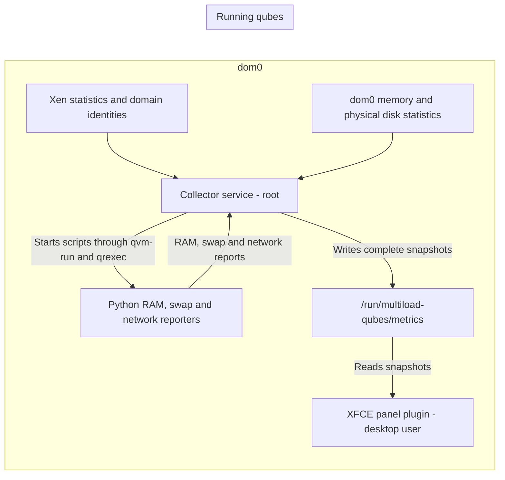

# Multiload for Qubes

A native GTK3 XFCE panel plugin with scrolling charts for whole-machine CPU,
RAM, network, swap and disk I/O.

Inspired by good old [indicator-multiload](https://github.com/mh21/indicator-multiload)
by Michael Hofmann, and the more modern [multiload-ng](https://github.com/udda/multiload-ng) by Mario Cianciolo.

Implemented primarily in Rust, with a small C adapter for the XFCE plugin
registration.

## Graphs

### Whole-machine CPU

A single filled chart, 100% means the full machine's CPU capacity.

### Per-qube CPU

Multiple independent lines chart, where every separate line corresponds to a
particular qube, and a line going to 100% means that single qube is at full CPU
capacity.

### Whole-machine RAM

A filled chart with 3 stacked layers:

- Used (reported as actually used by individual linux qubes, summed up)
- Allocated but unknown (e.g. allocated to non-linux qubes where we don't
  collect actual usage)
- Allocated but spare (reported as unused by individual linux qubes, summed up)

Where 100% is full machine RAM.

### Per-qube RAM

Multiple independent lines chart, where every separate line corresponds to a
particular qube, and a line going to 100% means that single qube is at full RAM
capacity.

### Network

A filled chart with 2 stacked layers: incoming and outgoing traffic through
sys-net. The scale adjusts automatically to the traffic speed.

### Per-qube swap

Multiple independent lines chart, where every separate line corresponds to a
particular qube, and a line going to 100% means that single qube's swap is full.

### Disk I/O

A filled chart with 2 stacked layers: reads and writes across physical disks,
including activity from all qubes and dom0. The scale adjusts automatically to
the traffic speed.

## Architecture

The project consists of two components:

- A systemd service collects data from Xen, dom0 and running qubes, and writes
  it to `/run/multiload-qubes/metrics`.
- An XFCE panel plugin reads that file and draws the charts.

Both components run in dom0.

The service also sends small Python scripts to Linux qubes to collect RAM, swap
and network data. Nothing needs to be installed in the qubes.

## Security

The collector runs as root in dom0. It reads CPU and RAM allocation from Xen,
memory and disk statistics from dom0, and RAM, swap and network reports from
qubes. The panel plugin runs as the desktop user and only reads the metrics
file. It does not connect to qubes.



By default, the collector tries to collect RAM and swap from all eligible
running qubes, and network data from `sys-net`. It does not start stopped
qubes. Collection continues even if you remove the panel plugin; stop the
systemd service `multiload-qubes-collector` to stop collection. The collector
has two options to disable qubes communication:

- `no-guest-memory`: if present, no RAM and swap info will be collected from
  qubes
- `no-network`: if present, no network info will be collected from `sys-net

So when both of these flags are provided, it disables all qubes communication,
and only xen data is used for the charts.

Reports from qubes are treated as untrusted input. The collector checks their
format and numbers, limits report size and frequency, and drops connections
that stop reporting. Guest error messages are shortened and cleaned before
being logged. Each connection has its own worker, so a slow qube does not
hold up the other measurements. The metrics file is owned by root and replaced
in one step, so the panel reads a complete snapshot. Missing or old reports
are shown as unavailable.

These checks do not prove that a report is true. A compromised qube can lie
about its RAM or swap usage, and a compromised `sys-net` can lie about network
traffic.

The same root process currently reads Xen statistics and parses guest reports.
The systemd service restricts filesystem writes and access to home directories,
but it still has privileged Xen and Qubes access. Its operations are intended
to only read statistics; those privileges do not enforce that limit. A bug in
guest report handling could therefore affect dom0. Separating that code into
a process with fewer privileges would improve this design, but is not
implemented yet.

Installing this package means trusting its code and the machine that built
it, since it runs in dom0. CI signs pre-built RPMs and checksums with Sigstore,
using its GitHub workflow identity. This lets you check where the package came
from; it does not prove that the code is safe.

## Installation

First you need the RPM package either download a pre-built one, or build it
manually as explained below.

Before copying a pre-built RPM to dom0, verify it in a regular qube using
[Cosign](https://docs.sigstore.dev/cosign/system_config/installation/).
Keep its original filename and place its matching `.sigstore.json` file beside it:

```bash
cosign verify-blob multiload-qubes-0.1.0-1.fc37.x86_64.rpm \
  --bundle multiload-qubes-0.1.0-1.fc37.x86_64.rpm.sigstore.json \
  --certificate-identity 'https://github.com/dimonomid/multiload-qubes/.github/workflows/_sign-binaries.yml@refs/heads/master' \
  --certificate-oidc-issuer https://token.actions.githubusercontent.com
```

Adjust the filename for your release. This is a separate signature check;
`dnf` does not verify these Sigstore signatures itself.

With the `multiload-qubes.rpm` already in dom0, run in dom0:

```bash
sudo dnf install ~/multiload-qubes.rpm
sudo systemctl enable --now multiload-qubes-collector.service
xfce4-panel -r
```

Then right-click on the xfce4 panel -> Panel -> Panel Preferences -> Items ->
Add, and select **Multiload for Qubes**.

Then, to change the settings, right-click the charts and select **Properties**.

## Building

Build in a Fedora qube matching your dom0 release:

```bash
sudo dnf install rust cargo gcc make pkgconf-pkg-config gtk3-devel xfce4-panel-devel xen-devel python3
cargo fetch --locked
make
make test
```

The plugin is built as `build/libmultiload-qubes.so`, and the collector as
`target/release/multiload-qubes-collector`.

### RPM for dom0

```bash
sudo dnf install rpm-build systemd-rpm-macros
make rpm
```

The RPM is written to `build/rpm/RPMS/`. This uses the same build and runs tests
before packaging.

To copy the RPM from the build qube to dom0, run in dom0 (adjust the qube name
and path):

```bash
qvm-run --pass-io dev 'cat /home/user/multiload-qubes.rpm' > ~/multiload-qubes.rpm
```
