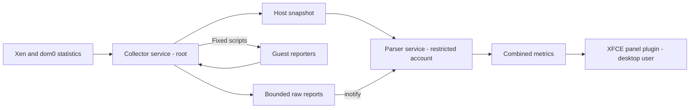

# Multiload for Qubes

A native GTK3 XFCE panel plugin with scrolling charts for whole-machine CPU,
RAM, network, swap and disk I/O, for [Qubes OS](https://www.qubes-os.org/).


Inspired by good old [indicator-multiload](https://github.com/mh21/indicator-multiload)
by Michael Hofmann, and the more modern [multiload-ng](https://github.com/udda/multiload-ng) by Mario Cianciolo.
None of these existing projects are usable on Qubes because of its
security-focused architecture; a very different approach is needed to implement
the same functionality.

Implemented from scratch, primarily in Rust, with a small C adapter for the
XFCE plugin registration.

## Graphs

### Whole-machine CPU

A single filled chart, 100% means the full machine's CPU capacity.

### Per-qube CPU

Multiple independent lines chart, where every separate line corresponds to a
particular qube, and a line going to 100% means that single qube is at full CPU
capacity.

### Whole-machine RAM

A filled chart with 3 stacked layers:

- Used (reported as actually used by individual linux qubes, summed up)
- Allocated but unknown (e.g. allocated to non-linux qubes where we don't
  collect actual usage)
- Allocated but spare (reported as unused by individual linux qubes, summed up)

Where 100% is full machine RAM.

### Per-qube RAM

Multiple independent lines chart, where every separate line corresponds to a
particular qube, and a line going to 100% means that single qube is at full RAM
capacity.

### Network

A filled chart with 2 stacked layers: incoming and outgoing traffic through
sys-net. The scale adjusts automatically to the traffic speed.

### Per-qube swap

Multiple independent lines chart, where every separate line corresponds to a
particular qube, and a line going to 100% means that single qube's swap is full.

### Disk I/O

A filled chart with 2 stacked layers: reads and writes across physical disks,
including activity from all qubes and dom0. The scale adjusts automatically to
the traffic speed.

## Architecture

The project runs two systemd services and an XFCE panel plugin in dom0:

- The collector service reads Xen and dom0 statistics, and runs fixed Python
  reporters in Linux qubes. It writes host statistics and raw guest reports
  (without parsing their measurement fields) under `/run/multiload-qubes-host/`.
- The parser service runs as the dedicated `multiload-qubes` user. It watches
  those files with inotify, parses them, and writes combined metrics to
  `/run/multiload-qubes/metrics`.
- The XFCE panel plugin reads the combined metrics and draws the charts.

Nothing needs to be installed in the qubes.

## Security

The collector service runs as root in dom0, has Xen and Qubes access, and is
designed to do absolute minimum that a privileged service has to do: collects
data from Xen, collects untrusted data from VMs without parsing their
measurement fields (using python scripts bundled with the application), and
stores both kinds of data on disk. These files and their directory are owned
by root and are not writable by others; VMs cannot choose their paths or
identities.

The separate parser service runs as a very restricted user in dom0: it has no
Linux capabilities, Xen devices, Qubes management sockets, network access, or
access to your home or desktop session. Its writable files are limited to its
runtime directory.  Systemd limits its memory, CPU and process count. It parses
the raw input files created by the collector service, and writes the resulting
combined output snapshot.

Then finally, xfce panel plugin runs as your main desktop dom0 user, reads the
combined snapshot that the parser previously wrote, and draws the charts.



By default, the collector tries to collect RAM and swap from all eligible
running qubes, and network data from `sys-net`. It does not start stopped
qubes. Collection continues even if you remove the panel plugin; stop the
systemd service `multiload-qubes-collector` to stop collection. The collector
has two options to disable qubes communication:

- `--no-qube-metrics`: if present, no RAM and swap info will be collected from
  qubes
- `--no-network`: if present, no network info will be collected from `sys-net`

So when both of these flags are provided, it disables all qubes communication,
and only host data is used for the charts.

Reports from qubes are treated as untrusted input. The parser checks their
format, numbers, freshness and domain identity. It resets network counters on
reconnection. Files are replaced in one step, so readers see complete snapshots.
Missing or old reports are shown as unavailable.

A compromised qube can lie about its RAM or swap usage, and a compromised
`sys-net` can lie about network traffic.

Installing this package means trusting its code and the machine that built it,
since it runs in dom0. CI signs pre-built RPMs and checksums with Sigstore,
using its GitHub workflow identity. This lets you check where the package came
from; it does not prove that the code is safe.

I did my best to keep dom0 safe when handling data from potentially compromised
qubes, but bugs can happen. The collector/parser split keeps guest measurement
parsing out of the privileged process. This reduces the possible impact of
parsing bugs, but does not 100% eliminate the risks of processing
guest-controlled data in dom0.

## Installation

First you need the RPM package either download a pre-built one, or build it
manually as explained below.

Before copying a pre-built RPM to dom0, verify it in a regular qube using
[Cosign](https://docs.sigstore.dev/cosign/system_config/installation/).
Keep its original filename and place its matching `.sigstore.json` file beside it:

```bash
cosign verify-blob multiload-qubes-0.1.0-1.fc37.x86_64.rpm \
  --bundle multiload-qubes-0.1.0-1.fc37.x86_64.rpm.sigstore.json \
  --certificate-identity 'https://github.com/dimonomid/multiload-qubes/.github/workflows/_sign-binaries.yml@refs/heads/master' \
  --certificate-oidc-issuer https://token.actions.githubusercontent.com
```

Adjust the filename for your release. This is a separate signature check;
`dnf` does not verify these Sigstore signatures itself.

With the `multiload-qubes.rpm` already in dom0, run in dom0:

```bash
sudo dnf install ~/multiload-qubes.rpm
sudo systemctl enable --now multiload-qubes-collector.service
xfce4-panel -r
```

Starting the collector also starts `multiload-qubes-parser.service` automatically.
To check both services:

```bash
systemctl status multiload-qubes-collector.service multiload-qubes-parser.service
```

Then right-click on the xfce4 panel -> Panel -> Panel Preferences -> Items ->
Add, and select **Multiload for Qubes**.

## Configuration

### Panel plugin

Right-click the charts and select **Properties** to change enabled charts,
their order and appearance. These settings only affect the
panel plugin; they do not change how the collector collects data.

### Collector

The collector is configured through command-line options in its systemd service.
In dom0, run:

```bash
sudo systemctl edit multiload-qubes-collector.service
```

This creates an override under
`/etc/systemd/system/multiload-qubes-collector.service.d/override.conf`.
For example, to collect network traffic from `sys-net-2` and sample host and
guest statistics every second, put:

```ini
[Service]
ExecStart=
ExecStart=/usr/libexec/multiload-qubes-collector --network-qube sys-net-2 --interval 1
```

The empty `ExecStart=` clears the original command. After saving, apply with:

```bash
sudo systemctl restart multiload-qubes-collector.service
```

Collector settings:

- `--network-qube NAME`: qube to collect network traffic from; default `sys-net`.
- `--no-network`: disable guest network collection.
- `--no-qube-metrics`: disable guest RAM and swap collection. Their RAM
  allocation is still counted, but actual usage is unknown.
- `--interval SECONDS`: host and guest collection interval, from `0.25` to `10`;
  default `1`.

To remove all local overrides for the collector service and restore defaults:

```bash
sudo systemctl revert multiload-qubes-collector.service
sudo systemctl restart multiload-qubes-collector.service
```

This does not change the panel plugin settings.

## Building

Build in a Fedora qube matching your dom0 release:

```bash
sudo dnf install rust cargo gcc make pkgconf-pkg-config gtk3-devel xfce4-panel-devel xen-devel python3
cargo fetch --locked
make
make test
```

The plugin is built as `build/libmultiload-qubes.so`, and the collector as
`target/release/multiload-qubes-collector`. The parser is built as
`target/release/multiload-qubes-parser`.

### RPM for dom0

```bash
sudo dnf install rpm-build systemd-rpm-macros
make rpm
```

The RPM is written to `build/rpm/RPMS/`. This uses the same build and runs tests
before packaging.

To copy the RPM from the build qube to dom0, run in dom0 (adjust the qube name
and path):

```bash
qvm-run --pass-io dev 'cat /home/user/multiload-qubes.rpm' > ~/multiload-qubes.rpm
```
